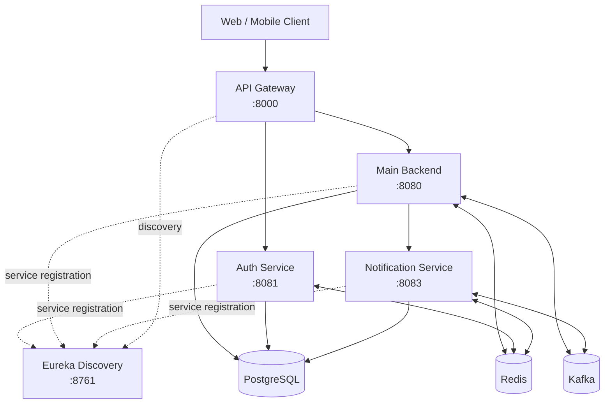
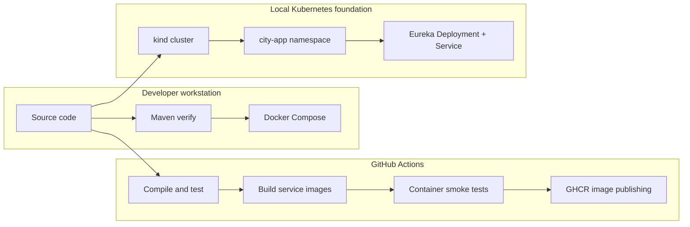

# City App

<p align="center">
  <strong>A modular, cloud-ready backend for a hyperlocal city marketplace</strong><br/>
  Bringing local commerce, community services, and delivery workflows together through a Java and Spring Boot platform.
</p>

<p align="center">
  
  
  
  
  
  
</p>

<p align="center">
  <a href="https://github.com/Mu-za-mil/city-app/actions"></a>
  <a href="https://github.com/Mu-za-mil/city-app"></a>
</p>

---

## Overview

**City App** is a backend platform concept for a connected local ecosystem. It brings neighborhood businesses, customers, schools, and delivery partners into one system instead of scattering everyday services across separate applications.

The repository is organized as a **Maven multi-module project** with independently containerized Spring Boot services. An API Gateway provides the intended entry point for client traffic, Eureka supports service discovery, and shared modules keep common application code and security components consistent.

The project is also a practical engineering environment for exploring service boundaries, API security, relational persistence, asynchronous messaging, containerization, CI validation, and a gradual path toward Kubernetes.

> **Project status:** The service-oriented backend and Docker-based workflow are the primary development path. Kubernetes manifests currently provide a local foundation, including the namespace and Eureka Deployment/Service; Kubernetes rollout of every service is not represented as complete.

## Product vision

City App is designed around a single local-services ecosystem:

- **Local marketplace** — discover neighborhood shops and browse products across categories such as groceries, electronics, food, gifts, and books.
- **Seller operations** — support seller-facing workflows such as inventory, billing, store availability, and order handling.
- **Orders and fulfilment** — provide a backend foundation for order lifecycle and delivery coordination.
- **Community and schools** — accommodate school notices and community-oriented information.
- **Promotions** — support concepts such as coupons, offers, and local advertising.
- **Multiple participant roles** — model different permissions for customers, sellers, school administrators, platform administrators, and delivery partners.

These are product-domain goals; availability and completeness of individual workflows depend on the implementation in the current branch.

## Contents

- [Architecture](#architecture)
- [Services and modules](#services-and-modules)
- [Technology stack](#technology-stack)
- [Architecture decisions](#architecture-decisions)
- [Security](#security)
- [Data and messaging](#data-and-messaging)
- [Local development](#local-development)
- [Configuration and secrets](#configuration-and-secrets)
- [API and health checks](#api-and-health-checks)
- [Testing and quality](#testing-and-quality)
- [CI pipeline](#ci-pipeline)
- [Kubernetes direction](#kubernetes-direction)
- [Repository layout](#repository-layout)
- [Troubleshooting](#troubleshooting)
- [Roadmap](#roadmap)
- [Contributing](#contributing)
- [License](#license)

## Architecture

### High-level system view

The intended request path is **Client → API Gateway → backend service**. The gateway is the edge routing layer; the backend services own their domain logic and use the supporting infrastructure where configured.



*Conceptual architecture, not a deployment guarantee: actual routes, service-to-service calls, and dependency usage are determined by the configuration and implementation of each service.*

### Request lifecycle

1. A client sends an HTTP request to the API Gateway.
2. The gateway applies its configured routing and security-related filters, then forwards the request to the relevant service.
3. The owning service validates input and executes its application/business logic.
4. Persistence and infrastructure interactions happen through the configured PostgreSQL, Redis, and Kafka integrations.
5. Where asynchronous events or notifications are used, the relevant consumer/service handles work outside the original request path.
6. Actuator health endpoints provide operational signals for local checks and container orchestration.

### Deployment view



The CI workflow validates Kubernetes manifest rendering but does **not** deploy to a cluster. The current Kubernetes base is intentionally incremental; the full application continues to use Docker Compose for its primary local multi-service workflow.

## Services and modules

| Module | Responsibility | Default port |
|---|---|---:|
| `api-gateway` | External HTTP entry point, request routing, gateway filters, and resilience integration | `8000` |
| `auth-service` | Authentication and identity-related workflows | `8081` |
| `city-app-backend` | Main application APIs and domain workflows | `8080` |
| `notification-service` | Notification-related processing and delivery integrations | `8083` |
| `eureka-server` | Service registry and discovery | `8761` |
| `cityapp-common` | Shared types and common application components | Library |
| `cityapp-security` | Reusable JWT/security components shared across services | Library |

Ports are the documented/default service ports; environment configuration or container mappings may change how they are exposed on a host.

### Why separate services?

- **API Gateway** centralizes the client-facing entry point rather than requiring clients to know each internal service address.
- **Auth Service** separates identity-related concerns from the main domain API.
- **Notification Service** gives notification workflows a distinct runtime and scaling boundary.
- **Eureka** provides service registration and discovery for compatible clients.
- **Shared libraries** reduce duplication without requiring every common concern to become a network service.
- **Main Backend** keeps the primary domain workflows together while service boundaries evolve.

This is a pragmatic service-oriented design: not every domain needs to become a microservice, and service extraction should be driven by clear ownership, deployment, or scaling needs.

## Technology stack

| Area | Technologies |
|---|---|
| Language/runtime | Java 21, Eclipse Temurin runtime images |
| Application framework | Spring Boot 3.5.x, Spring Security, Spring Web |
| Service communication | Spring Cloud Gateway, Spring Cloud Netflix Eureka |
| Resilience | Resilience4j integration through Spring Cloud CircuitBreaker |
| Build | Maven multi-module project |
| Persistence | Spring Data JPA, Hibernate, PostgreSQL |
| Database migrations | Flyway |
| Cache / fast shared state | Redis |
| Asynchronous messaging | Apache Kafka, Spring for Apache Kafka |
| API security | Spring Security, JWT components (JJWT), BCrypt where configured |
| Validation / mapping | Jakarta Bean Validation, MapStruct |
| Operations | Spring Boot Actuator |
| Containers | Docker, Docker Compose |
| CI | GitHub Actions |
| Registry | GitHub Container Registry (GHCR) |
| Kubernetes | kind, kubectl, Kustomize (local foundation) |

## Architecture decisions

### 1. Maven multi-module repository

The services live in one repository and share a parent POM. This gives the project one place to manage Java and framework versions, compile related modules together, and make coordinated changes across service boundaries.

**Trade-off:** a shared repository simplifies cross-service changes, but builds and releases need clear module dependencies and image-tagging rules.

### 2. API Gateway as the edge

Clients should use the gateway rather than call internal services directly. This creates one place for routing and gateway-level concerns while allowing backend services to retain domain ownership.

**Trade-off:** gateway configuration is critical. A bad route or filter can affect many client requests, so routing and authorization behavior should be tested explicitly.

### 3. PostgreSQL as the system of record

Relational data and transactional domain workflows belong in PostgreSQL. JPA/Hibernate provides persistence mapping, while Flyway manages versioned schema changes. The main backend configuration uses schema validation rather than allowing Hibernate to silently create or mutate production schemas.

**Trade-off:** relational integrity is valuable for transactional workflows, but schema changes need disciplined migrations and compatibility checks.

### 4. Redis for shared, low-latency state

Redis is available for use cases that benefit from fast access, such as security-related state or caching where implemented.

**Trade-off:** Redis data should have an explicit lifetime and recovery strategy. It should not accidentally become the only durable copy of important business data.

### 5. Kafka for asynchronous workflows

Kafka provides a message-broker foundation for decoupled event-driven processing. Producers, consumers, topic configuration, retries, and dead-letter handling must be considered together.

**Trade-off:** asynchronous messaging improves isolation but introduces eventual consistency, duplicate delivery, ordering, and observability concerns. Consumers should be designed with idempotency in mind.

### 6. Containers before full orchestration

Docker Compose is the simplest way to run the current multi-service system locally. Kubernetes is being introduced incrementally, starting with a local kind cluster and a small validated manifest base.

**Trade-off:** Compose is faster for local development; Kubernetes adds orchestration capabilities but also introduces cluster networking, probes, secrets, resource sizing, and rollout complexity.

## Security

Security-related building blocks in the repository include:

- Spring Security integration.
- JWT support using JJWT-based shared components.
- Password hashing with BCrypt where configured.
- Gateway and service-level security filters.
- Environment-based configuration for credentials and signing secrets.
- Redis integration for security-related shared state where configured.

### Security practices

- Never commit real credentials, signing keys, webhook secrets, or production connection strings.
- Use strong, environment-specific secrets; do not reuse development secrets in production.
- Keep authentication and authorization separate: a valid token does not automatically grant access to every role or resource.
- Enforce authorization at the service boundary for sensitive operations rather than relying only on the gateway.
- Validate inputs and avoid returning internal exception details to clients.
- Rotate exposed secrets immediately and invalidate affected credentials.
- Treat logs, traces, and error responses as potential sources of personal or credential data.

Security behavior is configuration-dependent; review the current security configuration and tests before using the project with real users or production data.

## Data and messaging

### Database migrations

Flyway migration files are maintained with the application. For local development, use the repository's configured PostgreSQL database and let the application apply the migrations.

Recommended practices:

1. Add a new migration rather than editing a migration that has already been applied.
2. Test migrations against a clean database and a database with existing data.
3. Keep schema changes compatible with application rollout order when services are deployed independently.
4. Back up important data before destructive database operations.

### Kafka

Kafka is part of the local infrastructure and CI smoke-test environment. When extending event-driven workflows, document the event schema, topic ownership, retry policy, dead-letter behavior, and idempotency strategy alongside the implementation.

### Redis

Redis is a supporting service, not a replacement for durable relational storage. Document key prefixes, TTLs, invalidation behavior, and failure handling for each new use case.

## Local development

### Prerequisites

Install the following before starting:

- **JDK 21** (Temurin recommended)
- **Maven** compatible with the project
- **Docker Desktop** with Docker Compose
- **Git**
- Optional for Kubernetes work: **kubectl** and **kind**

Verify the core tools:

```bash
java -version
mvn -version
docker --version
docker compose version
git --version
```

### 1. Clone the repository

```bash
git clone https://github.com/Mu-za-mil/city-app.git
cd city-app
git checkout develop
```

### 2. Configure the environment

The CI workflow uses `.env.example` to create a local `.env` file. Start with the example and adjust values for your environment:

```bash
cp .env.example .env
```

On Windows PowerShell:

```powershell
Copy-Item .env.example .env
```

Review the variables before starting the stack. Never commit the populated `.env` file.

### 3. Build and run tests

From the repository root:

```bash
mvn --batch-mode verify
```

This builds the Maven modules and runs the configured verification/test lifecycle. Resolve any test or configuration failures before building service images.

### 4. Start the Docker Compose stack

The repository's CI workflow uses the `infra` and `core` Compose profiles. To build images locally and start those profiles:

```bash
docker compose --profile infra --profile core up -d --build
```

Inspect the running containers:

```bash
docker compose --profile infra --profile core ps
docker compose logs -f
```

Stop the stack:

```bash
docker compose --profile infra --profile core down
```

To remove containers and networks as well as named volumes, use `down -v` **only when you intend to delete persisted local data**.

> If startup fails, check the required variables in `.env.example`, the Compose service profiles, host-port conflicts, and container health before changing application code.

### 5. Verify service health

The application services expose Spring Boot Actuator health endpoints where enabled. Typical local checks are:

| Service | Health URL |
|---|---|
| API Gateway | [http://localhost:8000/actuator/health](http://localhost:8000/actuator/health) |
| Auth Service | [http://localhost:8081/actuator/health](http://localhost:8081/actuator/health) |
| Main Backend | [http://localhost:8080/actuator/health](http://localhost:8080/actuator/health) |
| Notification Service | [http://localhost:8083/actuator/health](http://localhost:8083/actuator/health) |
| Eureka Dashboard | [http://localhost:8761](http://localhost:8761) |

These URLs assume the default ports are published to the host. If a port is not exposed, check the relevant Compose port mapping or use a container-network request.

## Configuration and secrets

Configuration is supplied through environment variables and Spring configuration files. The exact required variables are defined in `.env.example` and the service configuration.

Common configuration categories include:

- PostgreSQL JDBC URL, database username, and password.
- Redis host and port.
- Kafka bootstrap servers.
- Eureka service URL.
- JWT signing/verification settings.
- Mail, payment, or external integration credentials when those features are enabled.

**Do not paste real secrets into issues, pull requests, screenshots, logs, or documentation.** Keep `.env` local, use GitHub Actions secrets for CI-only credentials, and use Kubernetes Secrets or a dedicated secret manager for deployment environments.

## API and health checks

The API is split by service responsibility. Use the gateway for normal client-facing requests and consult each service's controllers and security configuration to determine the exact routes, request schemas, roles, and response contracts.

For every new endpoint, aim to document:

- HTTP method and path.
- Authentication requirements and permitted roles.
- Request and response examples.
- Validation and error responses.
- Idempotency behavior for operations that may be retried.
- Relevant persistence or asynchronous side effects.

Actuator health endpoints are operational checks, not a substitute for functional API tests. Avoid exposing sensitive Actuator endpoints publicly.

## Testing and quality

The project uses Maven's `verify` lifecycle in CI. The pipeline also starts the containerized application and smoke-tests health endpoints for all five services.

Useful local commands:

```bash
# Compile, test, package, and run configured verification checks
mvn --batch-mode verify

# Re-run verification with more Maven output
mvn verify

# Render the current Kubernetes base without deploying it
kubectl kustomize k8s/base
```

For changes to critical flows, add tests at the appropriate level:

- **Unit tests** for business rules and validation.
- **Web/security tests** for authentication, authorization, and error responses.
- **Repository/integration tests** for persistence and migrations.
- **Messaging tests** for event handling, retries, and duplicate delivery.
- **Smoke tests** for container startup and health.
- **Failure-path tests** for unavailable dependencies, invalid tokens, timeouts, and malformed input.

Do not treat a successful health check as proof that every business flow is correct.

## CI pipeline

The GitHub Actions workflow is defined in [`.github/workflows/ci.yml`](.github/workflows/ci.yml). It runs on pushes and pull requests targeting `develop`, and supports manual dispatch.

The workflow currently:

1. Checks out the repository and sets up Java 21.
2. Renders `k8s/base` with Kustomize and checks the expected namespace.
3. Runs `mvn verify` across the Maven project.
4. Builds Docker images for the API Gateway, Auth Service, Notification Service, Eureka Server, and Main Backend, tagged with the commit SHA.
5. Starts the CI Compose stack and runs the five-service health smoke test.
6. On pushes to `develop`, publishes verified service images to GitHub Container Registry (GHCR).

The pipeline's Kubernetes step is **manifest validation only**. It does not apply manifests to a cluster or perform a production deployment.

## Kubernetes direction

The Kubernetes work begins with a local `kind` cluster and the `city-app` namespace. The current `k8s/base` Kustomize base includes:

- The `city-app` namespace.
- An Eureka Deployment.
- An Eureka ClusterIP Service.
- Resource requests/limits and HTTP liveness/readiness probes for Eureka.

The local workflow uses explicitly tagged images and can use `imagePullPolicy: Never` for images loaded into the kind node. The broader rollout should proceed service by service, with configuration and secrets handled deliberately.

A typical next sequence is:

1. Validate the rendered manifests.
2. Build and load one service image into kind.
3. Deploy it with a Service and suitable probes.
4. Verify DNS, readiness, logs, and dependency connectivity.
5. Add the next service only after the previous checkpoint is healthy.
6. Add resource policies, autoscaling, network restrictions, and deployment automation when the workload and operational needs justify them.

PostgreSQL, Redis, and Kafka can remain in Docker Compose during early local Kubernetes work to keep the development environment manageable. Cross-environment networking must be configured explicitly; Kubernetes service DNS does not automatically resolve Compose service names.

## Repository layout

```text
city-app/
├── api-gateway/             # Client-facing gateway
├── auth-service/             # Authentication service
├── city-app-backend/         # Main domain backend
├── notification-service/     # Notification workflows
├── eureka-server/            # Service discovery
├── cityapp-common/           # Shared application module
├── cityapp-security/         # Shared security components
├── k8s/
│   └── base/                 # Kustomize namespace and Eureka resources
├── scripts/
│   └── ci/                   # CI smoke-test scripts
├── .github/
│   └── workflows/
│       └── ci.yml             # Build, test, image, and smoke-test pipeline
├── .env.example              # Example local configuration
├── docker-compose.yml        # Local multi-service environment
├── docker-compose.ci-smoke.yml
└── pom.xml                   # Maven parent and module definitions
```

## Troubleshooting

| Symptom | What to check |
|---|---|
| Maven build fails | Confirm JDK 21 is active; run `mvn -version`; inspect the first compilation/test error. |
| Service exits during startup | Read its logs and verify required environment variables and dependency availability. |
| Database connection refused | Check PostgreSQL container health, JDBC URL, credentials, and host/container port mapping. |
| Redis or Kafka connection fails | Verify the service is running and that the configured hostname is resolvable from the caller's network. |
| Gateway returns an authorization error | Check the request's Authorization header, token validity, gateway filters, and the downstream service's security configuration. |
| Eureka shows no registered services | Check each client's Eureka URL, startup logs, network access, and registration settings. |
| kind reports image pull errors | Build the expected tag, load it into the correct kind cluster, and confirm the Deployment's image name and pull policy. |
| Kubernetes pod is not Ready | Inspect `kubectl describe pod`, `kubectl logs`, probe configuration, resource limits, and dependency connectivity. |
| Host port is already allocated | Identify the process/container using the port or change the host-side mapping in local configuration. |

Helpful commands:

```bash
docker compose ps
docker compose logs --tail=200 <service-name>
kubectl get pods,svc -n city-app
kubectl describe pod <pod-name> -n city-app
kubectl logs <pod-name> -n city-app
kubectl kustomize k8s/base
```

## Roadmap

- [x] Organize the backend as a Maven multi-module repository.
- [x] Establish separate runtime modules for gateway, authentication, main backend, notification, and service discovery.
- [x] Add a CI workflow for Maven verification, service image builds, and health smoke tests.
- [x] Add a Kustomize base with a namespace and Eureka resources.
- [ ] Expand Kubernetes resources to cover the remaining application services.
- [ ] Document endpoint contracts and role-based access by domain.
- [ ] Strengthen automated integration and failure-path coverage as workflows mature.
- [ ] Evolve deployment automation after local Kubernetes behavior is repeatable.

Roadmap items reflect the intended engineering direction and should be updated as work is completed.

## Contributing

Contributions and focused improvements are welcome.

1. Create a feature branch from `develop`.
2. Keep changes scoped and add tests for behavior changes.
3. Run `mvn --batch-mode verify` locally.
4. If Docker, configuration, or Kubernetes behavior changes, validate the relevant Compose setup or render `k8s/base`.
5. Open a pull request with the problem, implementation, validation steps, and any configuration or migration notes.

For changes that affect shared modules such as `cityapp-common` or `cityapp-security`, consider the impact on every dependent service.

## License

No license has been confirmed in this README. Until a license file or repository license is added, all rights remain with the copyright holder and reuse should not be assumed to be permitted.

---

<p align="center">
  Built as an evolving backend engineering project — with an emphasis on clear service boundaries, reliable delivery, and learning through real implementation.
</p>
